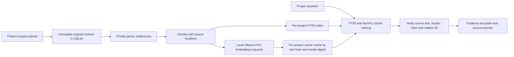

# M2 implemented document architecture

M2 adds retrieval and source verification to the existing M1/M3 service. It does not
add answer generation (M4), automatic risk analysis (M5), or an installer (M6).

Parent death also stops owned capture/model/parser children immediately, before
waiting for outstanding HTTP model requests to drain. This preserves M3 lifetime
safety when longer-running retrieval requests are introduced.

## Data ownership and revisions

Uploads use an authenticated octet-stream endpoint, a plain filename and optional
original filesystem modification time. No client filesystem path is accepted or read.
Original bytes are stored in SQLite, not extracted into a directory. A stable document
ID belongs to exactly one project. Uploading changed content under the same filename
creates a new immutable revision. Unchanged current content is detected by SHA-256 and
is not parsed/indexed again. Historical originals, extracted units and citations remain
available until document/project deletion.

Current chunks feed a separate FTS5 virtual table for each project, so another project's
term frequencies cannot affect lexical ranking. Virtual-table identifiers are derived
from a server-side hash; filenames/query syntax never become SQL identifiers. Foreign
keys cascade revision/chunk/fact/vector ownership on deletion, and scoped methods check
project/document relationships before reading, reindexing or deleting anything.

A citation ID incorporates project, immutable revision, ordinal, text hash and location.
Resolution rechecks the extracted-source slice, source location, SHA-256 text hash and
citation ID. Unknown, cross-project, deleted or inconsistent references fail closed.
The API returns file ID/name/hash, revision and its timestamp provenance, quote, locator
and bounded surrounding text. Retained older revisions are marked superseded; they are
not silently replaced by new text. The browser displays text, never imported HTML/PDF
scripts, document macros or external links. Source caches are bounded to four parsed
revisions and cleared on deletion; database scope checks precede cache access.

## Parsing and locations

pypdf handles text PDFs and page numbers. python-docx handles headings, body paragraphs
and table rows. python-pptx handles slide text and tables. openpyxl reads spreadsheet
rows/ranges without evaluating formulas or following external links. CSV uses row and
physical line numbers. Plain text, Markdown, code, JSON/YAML/XML, GraphQL, Proto and
OpenAPI specifications retain line/character locations; Markdown/symbol/endpoint
boundaries carry heading context. JSON and XML are validated, YAML uses SafeLoader,
and Office XML parts pass defusedxml checks before parsing. Macro-bearing archives,
DTD/entities, archive bombs, invalid formats and unsupported extensions are rejected.
No imported code is imported or executed as Python/JavaScript/etc.

Revision preference: PDF/Office modification metadata or recognized revision fields,
then browser-supplied original filesystem modification time, then import time. Dates
are normalized to UTC and exposed with their basis. A date field is source-provided
metadata, not an independently authenticated timestamp. Plain-text revision-field
scanning is limited to the first 50 lines; JSON additionally checks root/info fields.

Chunks stay inside source units and retain exact character ranges. Heading, function,
page, paragraph, slide and spreadsheet boundaries take priority over size splitting.
Large units are split at newlines where possible, capped near 1,100 characters.
No OCR or visual chart interpretation is performed; these remain outside M2's text
pipeline. Complex Office layout, grouped shapes, charts and image-only content need
further coverage before claiming comprehensive document extraction.

## Resource and privacy boundaries

One parser/indexer works at a time. Parsing uses a child process with a 45-second
wall-time limit, bounded output and low Windows process priority. Linux additionally
uses 1 GiB address-space and CPU-time limits; Windows hard memory containment is not
qualified here. Input is capped at 20 MiB, decoded text at two million characters,
source units at 10,000 and chunks at 4,000 per file. Archive extraction limits are
checked without writing parts to disk. Up to two upload bodies are consumed at once.
Initial limits are 50 documents and 20,000 current chunks per project. Limits cause
visible errors rather than silent truncation; original revisions consume local disk.

Active sessions defer new parsing/indexing; a session starting during parsing allows
that bounded parse to finish, then defers embedding batches. Query embedding requests
can run between background batches. M3 capture/ASR processes remain independent. This
is not a full M5 resource scheduler or proof of RTX 4080 concurrency stability.

Ollama is fixed to 127.0.0.1:11434, ignores outbound proxy settings for loopback and
never follows redirects. It requests exactly qwen3-embedding:0.6b, num_gpu=0,
num_ctx=2048, truncate=false and keep_alive=0. CPU placement/unloading is requested, not
GPU-residency evidence. Generation model choices were not changed. Query task prefixes
follow the Qwen retrieval pattern; documents are input data, never tool instructions.

Vectors are finite normalized float32 values with checked dimensions. Cache keys include
project, text hash, model and digest; unchanged chunks reuse vectors across revisions.
Model digest changes cannot silently mix spaces. Changed-model caches require reindex.
No hosted inference, downloads during search, external telemetry or cloud fallback.

## Ranking, conflicts and UI

Keyword matching uses quoted word tokens (up to 20) and project-local BM25. Semantic
similarity runs in bounded NumPy batches outside the API event loop. Reciprocal-rank
fusion combines candidate lists; revision recency resolves close score ties. A source
conflict panel explicitly prefers the newest relevant revision, even when a different
source matches a particular value more literally.

Conflict detection is a bounded heuristic over matching scoped key:value, key=value
and simple 'key is value' statements in different current documents. It flags potential
inconsistent values and exposes citations/timestamps. It does not claim comprehensive
natural-language contradiction detection or automatic truth resolution. At most 20
conflict groups and 10 evidence entries per group are shown; the fact scan is bounded.

The dashboard supports file selection/drag/drop, indexing phases/errors, project-scoped
keyword/hybrid/semantic search, source previews, reindex and confirmed deletion.
Source-change warnings distinguish stale search results; deleted-source previews are
hidden. Hybrid mode explicitly returns keyword-only results and a warning if embeddings
are unavailable; semantic-only mode returns an error. No deterministic or fake vectors
are used by the production application. Protocol/ranking test fixtures are test-only.
