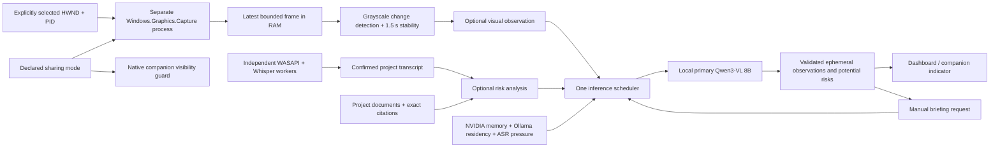

# M5 screen, sharing and resource architecture

M5 extends the M4 request pipeline and preserves the M2 source verifier and M3 isolated
capture/Whisper workers. Screen and risk state are ephemeral. Installer/onboarding and
release qualification remain M6/M7 work.

## Windows boundary

`services/screen-windows` is a separate .NET 8 console helper targeting Windows SDK
10.0.19041.56. Python passes configuration through inherited stdin/stdout pipes,
including the desktop/Python PIDs to exclude. Enumeration returns visible, non-minimized
top-level windows with nonempty titles. Copilot windows and the shell window are
excluded. There is no monitor capture route, active-window fallback or network listener.

The user selects an enumerated HWND/PID before a session (or while paused), then
explicitly enables capture after consent. The helper revalidates HWND/PID, visibility
and minimization during capture. It creates only that window's GraphicsCaptureItem,
a free-threaded D3D11 frame pool, and a capture session with the default OS border.
Window closure, invalid identity or capture failure stops this optional path. Resize
releases the old frame before recreating the pool. The parent never switches sources.

Readback/PNG encoding runs at most twice per second in the below-normal-priority helper.
Frames have a maximum 1,024-pixel long edge and 4 MiB encoded transport bound. Python
checks source, monotonically increasing sequence, actual PNG format and dimensions,
then makes a 32×18 grayscale signature and an in-memory JPEG with a 768-pixel long edge.
Only bounded current/in-flight frames remain in RAM. No screenshot/video path exists.
Parent death, cancellation, pause, stop and shutdown terminate the helper and clear
frames, observations and findings. A native failure leaves the meeting active.

The authenticated scoped preview endpoint returns only a fresh RAM frame, with
`Cache-Control: no-store`. The renderer uses a revocable Blob URL. A preview is a
single frame, not a recording or proof of Meet exclusion. Invalid/stale/wrong-project
previews fail closed.

## Changes, observations and risks

A normalized mean grayscale difference above 0.025 changes the candidate scene. The
scene must remain stable for at least 1.5 seconds. Background inference is limited to
one attempt per ten seconds, with no queued screen jobs. A persistent unchanged scene
is not repeatedly inferred. A scene change clears its previous observation immediately;
matching fresh frames can reaffirm an existing observation. Stale frames expire after
three seconds, and observations require fresh scene confirmation within thirty seconds.

The low-priority worker can analyze changed frames or newly confirmed transcript text.
Risk analysis is an explicit per-session opt-in and can work without screen capture.
It uses M2 lexical retrieval to avoid loading another model for optional retrieval.
At most two verified document excerpts and a bounded transcript subset are supplied.
Message JSON plus schema is capped at 2,560 UTF-8 bytes, leaving an estimated allowance
for the scaled image, output and template. The context remains 4,096 and output cap
384; actual token counts are checked. Image-token compatibility still needs real-model
measurement. Analysis has a thirty-second total deadline.

The generator uses the same primary Qwen3-VL 8B tag and digest checks as M4. Its separate
schema has only an observation and up to five potential risk hints, never a meeting
briefing. Categories cover feasibility, documentation contradictions, unresolved
requirements, missing dependencies, security, scalability and performance. English,
tentative wording and bounded fields are required. Evidence must reference supplied
transcript IDs, allowed document citations, or the supplied image. A document
contradiction requires both document and transcript evidence. No image means no visual
observation or screen-based evidence. Plain React text rendering escapes source content.

Sources are revalidated before publication and on every status read. Changed/deleted
citations, missing transcript evidence and expired findings are removed from display.
Findings expire after ninety seconds and stay scoped to the active project/session.
They are never saved by default, even after inspection. No M5 media, observations or
risk text is inserted into SQLite. Only resource settings are persisted.

A manual request freezes the current, same-project recent observation at trigger time
and includes up to 300 characters as explicitly unverified context within M4's existing
3,072-byte bound. Screen observations cannot become document citations. Absent, stale,
failed or not-yet-stable capture simply produces an unavailable-context warning.
Source validation and schemas do not prove factual correctness, risk accuracy or
resistance to every visual/text prompt injection; those remain qualification work.

## Inference admission

`Resources` owns one heavy-job lock shared by manual generation and optional visual/risk
inference. Valid manual questions preempt a background HTTP task before retrieval.
Optional work never queues behind a manual request. M2's embedding lock remains in use;
indexing is deferred during active meetings/manual work, and CPU speaker refinement
also defers for manual assistance. WASAPI and the ASR worker never acquire the heavy lock.

Before admission and every two seconds, a fixed-argument nvidia-smi subprocess measures
GPU total/free MiB and loopback `/api/ps` reads Ollama model residency. Probe processes
have deadlines; failed/unknown measurements disable GPU admission. The initial reserve
is 2,048 MiB and the primary-job budget is **an unmeasured 8,192 MiB estimate**, both
visible/configurable. For one NVIDIA GPU, a resident same-model context of at least
4,096 may be credited up to that budget. Multiple NVIDIA GPUs receive no uncertain
cross-device credit and currently use the conservative CPU/deferred path.

When the measured budget cannot fit, manual work retains the primary 8B model on CPU,
with four threads, `num_gpu=0` and `keep_alive=0`; optional work defers. Forced CPU mode
is also supported. GPU work uses a five-minute keep-alive. There is no automatic 4B
selection, unbounded queue or cloud fallback. The provided Ollama launcher binds
loopback and sets `OLLAMA_NUM_PARALLEL=1`; the app cannot configure an independently
running/external Ollama service.

A growing ASR queue (two chunks) or over-five-second measured chunk lag defers new
heavy inference and preempts active heavy work, including manual generation. A deferred
manual request fails explicitly instead of creating an answer queue. Two consecutive low-reserve or unavailable GPU samples cancel an active GPU
HTTP task. When idle and below reserve, only the app's primary model may be unloaded;
Ollama must confirm `done_reason=unload` before success is recorded. Other models are
not forcibly unloaded. A bounded event history records admission, profiles, elapsed
job times, cancellation/failures and unloading; it contains no prompts/media.

Client cancellation is verified; server/kernel cancellation timing is not. Ollama may
finish an already-admitted request before observing a disconnect. Sampling and a model
budget estimate cannot guarantee against allocation spikes/OOM. The M3 CPU recovery
path remains available, but the actual CPU/GPU tradeoff, reserve and responsiveness
must be measured with continuous Whisper on the target laptop.

## Declared sharing safeguards

Sharing state defaults to unknown on every launch and is not persisted. Tab/none modes
require acknowledgement. Broader/unknown modes always hide the companion, clear visual
state and stop optional screen work. Native show/hotkey paths check the authenticated
server state before displaying; an independent 250 ms native check (one request at a time, one-second timeout) catches browser
mode changes and hides on API failure. The desktop Apply control hides before changing
mode. Session startup preserves the declared mode rather than changing broader sharing
to tab mode. Clearing capture while paused never blocks resuming audio.

Both Electron windows request content protection as defense in depth. The UI supplies
Meet tab-sharing steps, selected-window preview, and a user-reported Meet preview
acknowledgement. `capture_exclusion_verified` and `meet_picker_enforced` always remain
false. The app does not detect or control Meet's native share picker. The user must
declare a change *before* starting broader sharing; polling is not an instantaneous
protection guarantee. Sharing the Copilot dashboard tab exposes its contents. Genuine
Windows/Meet exclusion testing remains unrun; no invisibility claim is made.
